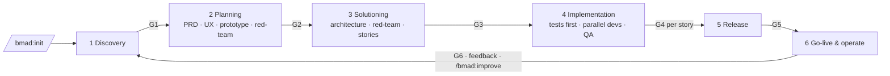

# BMAD Agentic Product Framework — Guide

A team of specialist AI agents that takes a product from requirement gathering to
production go-live and back into the next iteration, following BMAD principles:
document-driven hand-offs, one specialist per concern, phase gates with human approval, and
self-contained stories for developers.

What sets it apart from a collection of prompts: the rules are **enforced** by a tool and
hooks, acceptance tests are written and locked **before** the code, every plan is attacked
by an **adversarial reviewer** before it is approved, and the framework itself is
**measured** by an eval harness.

It runs in **Claude Code** — the terminal CLI, the desktop app, or the Claude Code extension
in **Visual Studio Code**. It needs Node.js 18 or later for the tool and hooks; nothing else.

## Install

**Into a project (recommended).** Clone this repository, then:

```bash
node bmad/tools/install.mjs /path/to/your/project
```

It copies the agents, commands and `bmad/` folder, and merges the hook, the MCP server and
the orchestrator rules into the project's existing `.claude/settings.json`, `.mcp.json` and
`CLAUDE.md` without overwriting them. The commands are installed as `/bmad-init`,
`/bmad-auto` and so on (see *Command names* below).

**As a Claude Code plugin.**

```bash
claude plugin marketplace add mliebski/bmad-agentic-framework
```

```bash
claude plugin install bmad@bmad-agentic-framework
```

As a plugin the commands are namespaced (`/bmad:init`, `/bmad:auto`, …) and
`/bmad:init` copies the `bmad/` assets into the project on first use. The orchestrator rules
then come from the `bmad:orchestrator` skill instead of a `CLAUDE.md`, and a session-start
hook reminds Claude to load it in a BMAD project.

**To try it from a clone** without installing anything: `claude --plugin-dir /path/to/clone`.

### Command names

The sources and this guide write commands as `/bmad:<name>`, the way Claude Code shows a
plugin's commands. A copied install (`install.mjs`) stores them as `bmad-<name>.md` and rewrites
every reference, so a project uses `/bmad-<name>`; a bare `/init` would clash with Claude Code's
built-in command. Both forms run the same command. The `bmad/` copy in your project always
matches the form you installed.

## Quick start

1. `/bmad:init My Product — one-line idea`
2. `/bmad:auto` — the framework works to the next gate and stops for your decision.
   Or drive it step by step; `/bmad:help` always names the next command.

## The team

| Agent | Role | Main outputs |
|---|---|---|
| `business-analyst` | Discovery and requirements | Project brief, research, requirements, feedback log |
| `product-manager` | What and why | PRD, epics, stories, backlog priorities |
| `ux-specialist` | Experience design | UX spec, clickable prototype |
| `solution-architect` | How it is built and run | Architecture, ADRs, runbook, go-live checklist |
| `developer` | Implementation — **spawnable in parallel** | Code, unit tests, Dev Record in the story |
| `qa-tester` | Independent verification | Test strategy, **acceptance tests before code**, story reviews, release QA report |
| `documentation-writer` | Docs | README, user guide, API reference, release notes |
| `marketing-specialist` | Go-to-market | Market positioning, launch plan, launch content |
| `adversarial-reviewer` | Breaks things on purpose | Findings on PRD, architecture, stories, code |
| `synthetic-user` | Plays one persona | Friction report from walking the prototype |

Extension packs add more: `node bmad/tools/bmad.mjs pack add security` (security
specialist, threat model, security gate items) and `pack add compliance` (privacy and
compliance specialist, data inventory, evidence).

The main Claude session is the **orchestrator** (rules in `CLAUDE.md`): it delegates, and
stops at every gate for your decision.

## The lifecycle



| Command | What it does |
|---|---|
| `/bmad:init` | Choose track, create `docs/` structure and status |
| `/bmad:help` | Where are we, what is next |
| `/bmad:auto` | **Autopilot** — run everything up to the next gate (or `to G3`, `all`) |
| `/bmad:discover` | Business analyst (+ marketing) — brief, research, requirements |
| `/bmad:prd` | Product manager — PRD |
| `/bmad:ux` | UX specialist — UX spec |
| `/bmad:prototype` | Clickable prototype, walked by synthetic users, findings fed back |
| `/bmad:redteam` | Adversarial review of `prd`, `ux`, `architecture`, `stories` or `code <story>` |
| `/bmad:architect` | Architect — architecture and ADRs; QA — test strategy |
| `/bmad:stories` | Product manager — epics and self-contained stories |
| `/bmad:gate G1..G6` | Machine checks, judgement checks, then your approve / reject / waive |
| `/bmad:sprint` | QA writes and locks acceptance tests → developers in parallel → QA review |
| `/bmad:qa` | Acceptance tests for a story, review a story, or release QA |
| `/bmad:release` | QA report, documentation, runbook, launch plan |
| `/bmad:golive` | Go-live checklist, go/no-go, guided cut-over, hypercare |
| `/bmad:retro` | Retrospective and feedback into the next iteration |
| `/bmad:improve` | Evidence-based proposals to improve the framework's own agents and gates |
| `/bmad:change` | Course correction across PRD, architecture and stories, starting from computed impact |
| `/bmad:party` | Roundtable — several agents weigh in on one question |

Details: `bmad/lifecycle.md` (phases, tracks, what is enforced) and `bmad/gates.md`
(gate checklists; items marked ⚙ are machine-checked).

## What makes the output trustworthy

**Enforced gates.** `node bmad/tools/bmad.mjs` owns the project state. It refuses to record
a gate as passed while its checks fail (missing artifacts, requirements without acceptance
criteria, NFRs without numbers, must-have requirements with no story, dependency cycles,
unresolved critical review findings, …). Hooks stop developers from starting before G3,
from editing outside their story, and anyone from hand-editing the state.

**Tests before code.** For each story QA writes executable acceptance tests from the
acceptance criteria, sees them fail, and locks them (file hashes). The developer's job is to
make them pass; edits to locked tests are blocked, and tampering through the shell is
caught by the hash check when the story is closed and again at release.

**Adversarial review.** The PRD and the architecture must each survive a reviewer whose
only job is to break them. Gates G2 and G3 stay shut while a critical finding is open,
unless you accept the risk.

**Prototype first.** The key flows become a clickable single-file prototype in phase 2 and
are walked by synthetic personas before any architecture exists. This is a cheap first
filter; it does not replace watching one real user.

## Autonomy

`/bmad:auto` chains the steps of a phase, fixes what the validator reports, batches the
agents' questions, and stops at the gate. In `bmad/config.yaml`, `autopilot.auto_pass`
lists gates it may pass on its own when the checks are clean — empty by default. It can
never pass G6: go-live is always a human decision, and no agent deploys.

Unattended: `claude -p "/bmad:auto to G3 --answers answers.md"` with an answers file.

## Requirements graph

`node bmad/tools/bmad.mjs trace` — every requirement with its stories, decisions and tests.
`impact FR-3` — what is affected if it changes. `context E1-S2` — the requirement and
decision texts a story must embed. The same is available to the agents as MCP tools
(`bmad_trace`, `bmad_impact`, `bmad_story_context`, `bmad_wave`, `bmad_validate`, …)
through the bundled zero-dependency MCP server (`.mcp.json`). The graph is an index derived
from the documents on every call; the documents remain the source of truth.

## Measuring and improving the framework

- **`evals/`** — reference projects run headless and scored (gate structure, required
  coverage, scope discipline, optional LLM judge). Run it before and after changing any
  agent, template or gate: `node evals/run.mjs`. See `evals/README.md`.
- **`/bmad:improve`** — reads a project's metrics (`docs/bmad-metrics.jsonl`: every gate
  failure, refusal and story bounce), finds recurring causes, and writes a proposal with the
  exact change to an agent or template. Nothing is applied automatically; check the
  proposal against the evals first.

## How developers spawn

`/bmad:sprint` asks the tool for the next **wave**: ready stories whose dependencies are
done, whose acceptance tests are locked, and whose `touches` do not overlap. It starts one
`developer` per story in parallel (up to `developer.max_parallel`). In a git repository
each works in its own worktree and branch, and you approve the merges; without git, stories
run one at a time. A `developer` given a whole epic acts as lead and spawns workers itself.

## Tracks

`quick` (bug fix or small feature, 1–5 stories), `standard` (a product or large feature),
`enterprise` (regulated or high-availability; add the security and compliance packs).

## Safety model

- Every gate ends with an explicit question to you; approval is never inferred.
- No agent deploys, migrates shared data, pushes, merges, or publishes marketing content.
- QA re-runs tests itself and reports failures as failures.
- The hooks are guardrails against drift, not a security sandbox: they see file-edit tools,
  not shell commands.

## Folder layout

```
CLAUDE.md                 orchestrator rules (generated from the skill)
skills/orchestrator/      the same rules as a plugin skill — the single source
.claude/agents/           the agents
.claude/commands/         commands, stored without prefix (/bmad:<name> as plugin)
.claude/settings.json     hook registration
.mcp.json                 BMAD MCP server registration
.claude-plugin/, hooks/   plugin and marketplace manifests, plugin icon, plugin hooks
bmad/config.yaml          track, developer, gate, review and autopilot settings
bmad/lifecycle.md         phases, tracks, enforcement, state
bmad/gates.md             gate checklists G1–G6
bmad/templates/           document templates
bmad/tools/               bmad.mjs (CLI + hook), mcp-server.mjs, install.mjs
bmad/packs/               extension packs
bmad/improvements/        proposals from /bmad:improve
evals/                    eval harness and reference projects
docs/                     created by /bmad:init — all project artifacts
```

## Customising

- Change an agent's behaviour: edit its file in `.claude/agents/` — then run the evals.
- Add a pack: a folder in `bmad/packs/` with `pack.json`, `agents/*.md` and `gates.md`.
- Tighten or relax a gate: edit `bmad/gates.md`; machine checks live in `validate()` in
  `bmad/tools/bmad.mjs`.
- Turn enforcement down for a project: `developer.tests_first`, `developer.enforce_touches`,
  `reviews.required`, `gates.ux_required` in `bmad/config.yaml`.
