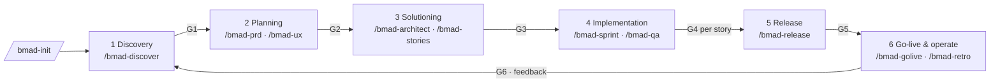

# BMAD Agentic Product Framework — Guide

A team of eight specialist AI agents that takes a product from requirement gathering to
production go-live and back into the next iteration, following BMAD principles:
document-driven hand-offs, one specialist per concern, phase gates with human approval, and
self-contained stories for developers.

It runs in **Claude Code** — the terminal CLI, the desktop app, or the Claude Code extension
in **Visual Studio Code**. All three read the same `.claude/` folder, so nothing else needs
installing.

## Quick start

1. Open this folder in Claude Code (in VS Code: install the "Claude Code" extension, open
   the folder, open the Claude panel).
2. Run `/bmad-init My Product — one-line idea`.
3. Follow `/bmad-help` — it always names the next command.

## The team

| Agent | Role | Main outputs |
|---|---|---|
| `business-analyst` | Discovery and requirements | Project brief, research, requirements, feedback log |
| `product-manager` | What and why | PRD, epics, stories, backlog priorities |
| `ux-specialist` | Experience design | UX spec — flows, wireframes, states, accessibility |
| `solution-architect` | How it is built and run | Architecture, ADRs, runbook, go-live checklist |
| `developer` | Implementation — **spawnable in parallel** | Code, tests, Dev Record in the story |
| `qa-tester` | Independent verification | Test strategy, story reviews, release QA report |
| `documentation-writer` | Docs | README, user guide, API reference, release notes |
| `marketing-specialist` | Go-to-market | Market positioning, launch plan, launch content |

The main Claude session is the **orchestrator** (rules in `CLAUDE.md`): it delegates, tracks
state in `docs/bmad-status.yaml`, and stops at every gate for your decision.

## The lifecycle



| Command | What it does |
|---|---|
| `/bmad-init` | Choose track, create `docs/` structure and status file |
| `/bmad-help` | Where are we, what is next |
| `/bmad-discover` | Business analyst (+ marketing) — brief, research, requirements |
| `/bmad-prd` | Product manager — PRD |
| `/bmad-ux` | UX specialist — UX spec |
| `/bmad-architect` | Architect — architecture and ADRs; QA — test strategy |
| `/bmad-stories` | Product manager — epics and self-contained stories |
| `/bmad-gate G1..G6` | Run a gate checklist and record your approve / reject / waive |
| `/bmad-sprint` | Spawn developers in parallel, then QA-review each story |
| `/bmad-qa` | Review a story, or run release QA |
| `/bmad-release` | QA report, documentation, runbook, launch plan |
| `/bmad-golive` | Go-live checklist, go/no-go, guided cut-over, hypercare |
| `/bmad-retro` | Retrospective and feedback into the next iteration |
| `/bmad-change` | Course correction across PRD, architecture and stories |
| `/bmad-party` | Roundtable — several agents weigh in on one question |

Details: `bmad/lifecycle.md` (phases, tracks, status file format) and `bmad/gates.md`
(gate checklists).

## How developers spawn

- **`/bmad-sprint`** — the orchestrator reads `sprint-status.yaml`, picks `ready` stories
  whose dependencies are done and whose `touches` lists do not overlap, and starts one
  `developer` agent per story in parallel (up to `developer.max_parallel` in
  `bmad/config.yaml`). In a git repository each developer works in its own worktree and
  branch; you approve the merges. Without git, stories run one at a time.
- **Lead developer session** — start `claude --agent developer` in a terminal. As the main
  session the developer agent can spawn worker `developer` agents itself for an epic.
  (Claude Code does not let a subagent spawn further subagents, which is why fan-out happens
  from the main session in both modes.)

## Tracks

`quick` (bug fix or small feature, 1–5 stories), `standard` (a product or large feature),
`enterprise` (regulated or high-availability; adds threat model, performance plan, rollback
rehearsal). Set by `/bmad-init`, stored in `bmad/config.yaml`.

## Safety model

- Every gate ends with an explicit question to you; approval is never inferred.
- No agent deploys, migrates shared data, pushes, merges, or publishes marketing content.
  Agents write the runbook and the drafts; you run and send them.
- QA re-runs tests itself and reports failures as failures.

## Folder layout

```
CLAUDE.md                 orchestrator rules
.claude/agents/           the eight agents
.claude/commands/         /bmad-* commands
bmad/config.yaml          track, paths, developer settings
bmad/lifecycle.md         phases, tracks, status format
bmad/gates.md             gate checklists G1–G6
bmad/templates/           document templates
docs/                     created by /bmad-init — all project artifacts
```

## Customising

- Change an agent's behaviour: edit its file in `.claude/agents/` (plain Markdown).
- Add an agent (e.g. security or data specialist): add a file there, then reference it in
  the relevant command and in `CLAUDE.md`.
- Tighten or relax a gate: edit `bmad/gates.md`.
- Adapt a document: edit its template in `bmad/templates/`.
- Use it in another project: copy `CLAUDE.md`, `.claude/` and `bmad/` into that repository.
