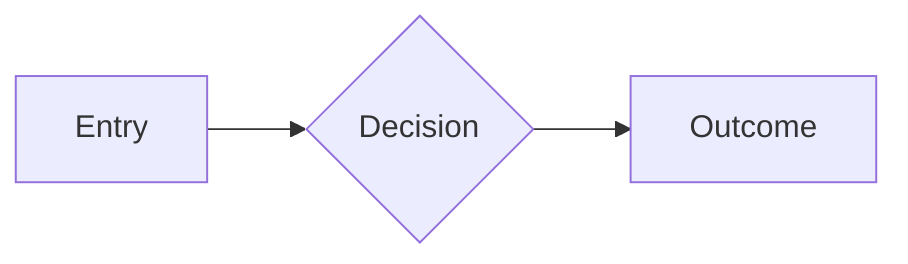

# UX Specification — {project name}

_Status: draft | Owner: ux-specialist | Date: {date}_

## 1. Experience principles
Three to five, specific to this product.

## 2. Personas and key scenarios

## 3. Information architecture
Site map or navigation model (Mermaid).

## 4. User flows
One per key scenario.



## 5. Screens
Repeat per screen.

### S-1 {screen name}
- **Purpose / FRs covered:**
- **Wireframe:**
```
+--------------------------------+
| Header                         |
| [ Primary action ]             |
+--------------------------------+
```
- **Components:**
- **States:** default · empty · loading · error · success · no permission
- **Copy:** labels, helper text, error messages (real text)
- **Interactions and validation:**

## 6. Design tokens
Colour, typography, spacing, radius — or a reference to the existing design system.

## 7. Accessibility (WCAG 2.2 AA)
Keyboard paths, focus order, contrast, labels, motion.

## 8. Responsive behaviour
Breakpoints and what changes at each.

## 9. Traceability
| FR | Flow | Screen(s) |
|---|---|---|

## 10. Conflicts with the PRD / open questions
